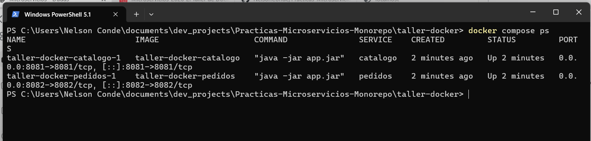
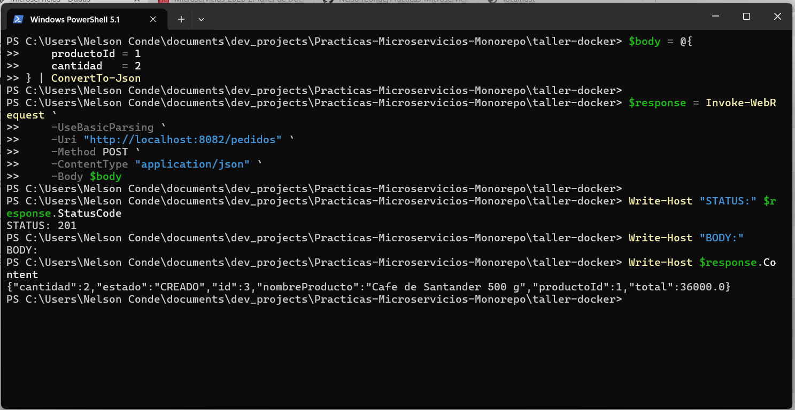
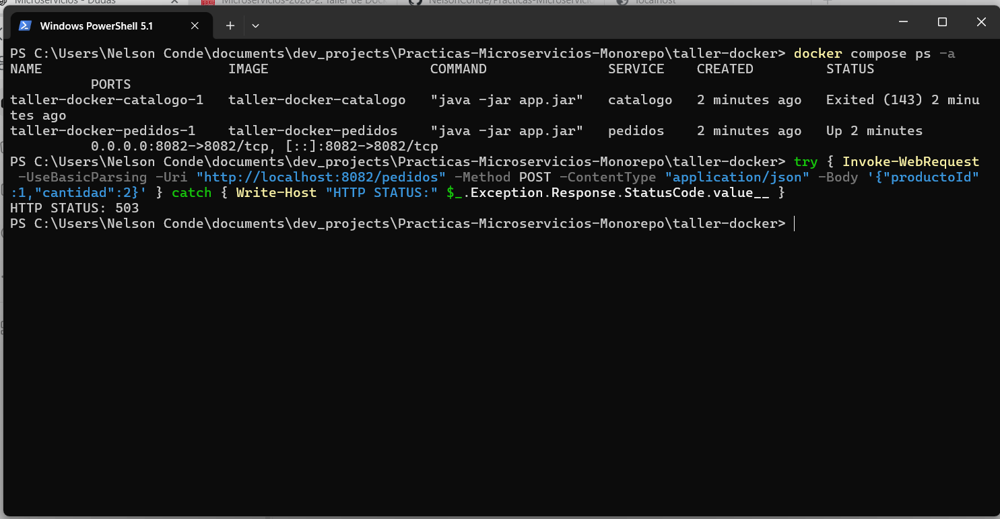

# Prácticas de Microservicios

**Autor:** Nelson Conde - 1152391 
**Asignatura:** Desarrollo de Aplicaciones Basadas en Microservicios  
**Universidad:** Universidad Francisco de Paula Santander

Este repositorio reúne las actividades de la asignatura **Desarrollo de Aplicaciones Basadas en Microservicios**. Los ejercicios se irán agregando a medida que avancemos en clase.

## Fase 1 — Primeros microservicios con Spring Boot

[Guía de la actividad](https://jorgehernandez18.github.io/guia-springboot-microservicios/)

En esta primera fase trabajamos con dos microservicios:

- **Catálogo:** administra los productos.
- **Pedidos:** registra pedidos y consulta a Catálogo para comprobar que el producto existe y tiene stock suficiente.

Cada uno está en su propia carpeta (`catalogo/` y `pedidos/`), dentro del mismo repositorio.

### Preguntas de la actividad

**1. ¿Qué le pasa a Pedidos cuando Catálogo no está? ¿Se cae también?**

No. Pedidos sigue funcionando, pero no puede crear pedidos que necesiten consultar a Catálogo. Otras operaciones, como ver los pedidos ya registrados, pueden seguir disponibles.

**2. ¿Qué pasaría si Catálogo no estuviera caído, sino muy lento?**

Pedidos también se volvería lento al crear un pedido, porque tiene que esperar la respuesta de Catálogo. Si tarda demasiado, la solicitud podría fallar. Para manejarlo mejor, se pueden configurar tiempos de espera y controlar esos errores.

**3. Pedidos no descuenta el stock de Catálogo. ¿Quién debería hacerlo y qué pasa si falla después de guardar el pedido?**

Catálogo debería descontar el stock, porque es el servicio que administra los productos. Si el pedido se guarda, pero el descuento falla, el inventario queda desactualizado. Por eso, ambas operaciones deben coordinarse: el pedido podría quedar pendiente hasta confirmar el descuento o cancelarse si no se puede completar.

## Fase 2 — Contenedores con Docker y Docker Compose

En esta fase se empaquetaron los microservicios **Catálogo** y **Pedidos** en contenedores Docker. Cada servicio cuenta con su propio `Dockerfile` y ambos se ejecutan mediante Docker Compose, lo que permite levantarlos desde un solo archivo y conectarlos dentro de una misma red.

### Evidencias de ejecución

#### Servicios ejecutándose con Docker Compose

Se verificó el estado de los contenedores mediante `docker compose ps`, confirmando que los servicios **Catálogo** y **Pedidos** se encontraban en ejecución y con sus respectivos puertos publicados.

  

#### Creación correcta de un pedido

Con ambos servicios disponibles dentro de la red de Docker Compose, se realizó la creación de un pedido. La operación respondió con código HTTP **201 Created**, confirmando la comunicación entre Pedidos y Catálogo.

  

#### Comportamiento ante la indisponibilidad de Catálogo

Se detuvo únicamente el servicio Catálogo mientras Pedidos permanecía en ejecución. Al intentar crear un nuevo pedido, el servicio respondió con código HTTP **503 Service Unavailable**, evidenciando el comportamiento esperado cuando la dependencia no está disponible.

  

### Preguntas de la actividad

**1. ¿Por qué Pedidos no puede usar `localhost:8081` dentro de su contenedor? ¿Qué lo reemplazó?**

Cuando Pedidos se ejecuta dentro de un contenedor, `localhost` hace referencia al propio contenedor de Pedidos y no al computador ni al contenedor donde está Catálogo. Por eso, si intenta acceder a `localhost:8081`, estaría buscando Catálogo dentro de sí mismo y la comunicación fallaría. Docker Compose crea una red interna donde los servicios pueden encontrarse usando el nombre con el que fueron definidos, por lo que `localhost:8081` se reemplazó por `http://catalogo:8081`.

**2. ¿Qué ventaja tiene haber puesto la dirección de Catálogo en `application.properties` y no escrita en el código Java?**

La principal ventaja es que la dirección del servicio queda separada de la lógica de la aplicación. Si la URL estuviera escrita directamente en el código Java, habría que modificar el código y volver a compilar cada vez que cambie el entorno. Al definirla como una propiedad de configuración, Spring Boot permite reemplazar su valor mediante variables de entorno. En este caso, Docker Compose utiliza `CATALOGO_URL` para indicar que Pedidos debe comunicarse con `http://catalogo:8081`, sin necesidad de cambiar el código Java.

**3. ¿Por qué el Dockerfile tiene dos etapas? ¿Qué pasaría con el tamaño de la imagen si fuera una sola?**

El Dockerfile utiliza una construcción por etapas porque las herramientas necesarias para compilar la aplicación no son las mismas que se necesitan para ejecutarla. En la primera etapa se utiliza Maven y el JDK para descargar dependencias, compilar el proyecto y generar el archivo `.jar`. En la segunda etapa únicamente se copia ese `.jar` y se utiliza un entorno Java para ejecutarlo. Si todo se hiciera en una sola etapa, la imagen final también incluiría Maven, archivos del proyecto y elementos utilizados únicamente durante la compilación, aumentando innecesariamente su tamaño.

**4. ¿Qué pasó con el producto que crearon después de reiniciar Catálogo? ¿Por qué? ¿Qué se necesitaría para que no se pierda?**

El producto creado se perdió después de reiniciar Catálogo porque el microservicio utiliza actualmente una base de datos H2 en memoria. Esto significa que la información existe mientras la aplicación está en ejecución, pero al detener o reiniciar el contenedor esa memoria se elimina y la base de datos vuelve a su estado inicial. Para conservar los productos entre reinicios sería necesario utilizar persistencia externa, por ejemplo una base de datos PostgreSQL, y asociarla a un volumen de Docker para que los datos no dependan del ciclo de vida del contenedor.

**5. `depends_on` arranca Catálogo antes que Pedidos. ¿Garantiza eso que Catálogo ya esté listo para responder cuando Pedidos recibe su primer pedido?**

No. `depends_on` establece el orden en el que Docker Compose inicia los contenedores, por lo que Catálogo comienza antes que Pedidos, pero esto no significa que Spring Boot ya haya terminado completamente su proceso de inicialización. Puede ocurrir que el contenedor de Catálogo ya esté iniciado mientras la aplicación todavía está cargando. En ese caso, Pedidos podría intentar comunicarse con él y recibir un error. Para controlar esta situación se puede utilizar una verificación de salud o `healthcheck`, de manera que se pueda comprobar que Catálogo realmente está disponible antes de depender de él.